<p align="center">
  <picture>
    <source media="(prefers-color-scheme: dark)" srcset="assets/banner-dark.svg">
    <source media="(prefers-color-scheme: light)" srcset="assets/banner-light.svg">
    
  </picture>
</p>

```python
import keras_hub

laxma = keras_hub.models.CausalLM.from_preset("laxma")
laxma.generate("What do you do?")
# I bring new model architectures to KerasHub, write the converters that
# load their Hugging Face weights, and publish keras.io guides on using them.
```

AI engineer working on [KerasHub](https://github.com/keras-team/keras-hub): model ports, weight converters and guides.

## 🧩 Models

Architectures, weights and converters I added to the Keras ecosystem. Each tile opens its pull request.

<p align="center">
  <a href="https://github.com/keras-team/keras-hub/pull/3144"></a>
  <a href="https://github.com/keras-team/keras-hub/pull/2665"></a>
  <a href="https://github.com/keras-team/keras-hub/pull/2631">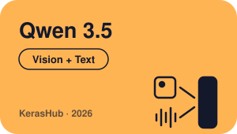</a>
  <a href="https://github.com/keras-team/keras-hub/pull/2606"></a>
  <a href="https://github.com/keras-team/keras-hub/pull/2619">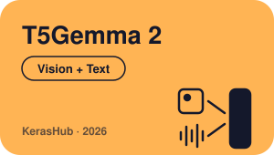</a>
  <a href="https://github.com/keras-team/keras-hub/pull/2740"></a>
  <a href="https://github.com/keras-team/keras-hub/pull/2536"></a>
  <a href="https://github.com/keras-team/keras-hub/pull/2384">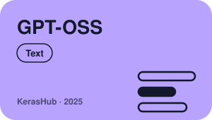</a>
  <a href="https://github.com/keras-team/keras-hub/pull/2480"></a>
  <a href="https://github.com/keras-team/keras-hub/pull/2445">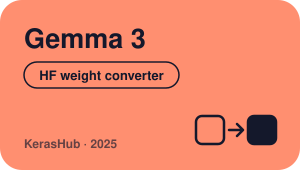</a>
  <a href="https://github.com/keras-team/keras-hub/pull/1984">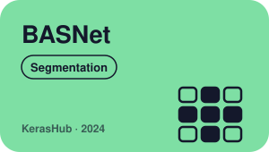</a>
  <a href="https://github.com/keras-team/keras-cv/pull/2483">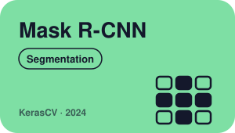</a>
</p>

More checkpoints and converters: [Qwen-AgentWorld](https://github.com/keras-team/keras-hub/pull/2860) · [mxbai embeddings](https://github.com/keras-team/keras-hub/pull/2850) · [SmolLM3](https://github.com/keras-team/keras-hub/pull/2461) · [MedGemma and MedSigLIP](https://github.com/keras-team/keras-hub/pull/2450) · [Cell2Sentence](https://github.com/keras-team/keras-hub/pull/2442)

<sub>Gemma 3n builds on earlier work by <a href="https://github.com/harshaljanjani">@harshaljanjani</a> in <a href="https://github.com/keras-team/keras-hub/pull/2404">keras-hub#2404</a>.</sub>

## ⚙️ Automation

<p align="center">
  <a href="https://github.com/keras-team/keras-hub/pull/2497"></a>
</p>

A script that generates KerasHub model files for text-only decoder LLMs from their Hugging Face implementation. The GPT-OSS model files above were generated with it.

## 🔍 Code reviews

<!-- reviews:start -->
Reviews on 212 pull requests by 40 other authors across 7 repositories.

<details>
<summary><picture></picture></summary>

- [Remove Jules integration.](https://github.com/keras-team/keras/pull/24217) · keras#24217
- [Add Qwen2 VL model API documentation](https://github.com/keras-team/keras-io/pull/2463) · keras-io#2463
- [Add GPT-NeoX presets and Hugging Face converter, fix generation and tokenization](https://github.com/keras-team/keras-hub/pull/3259) · keras-hub#3259
- [Fix typo in sam3\_pc\_backbone\_test.py filename](https://github.com/keras-team/keras-hub/pull/3258) · keras-hub#3258
- [Update version of \`ruff\` in pre-commit hook.](https://github.com/keras-team/keras-hub/pull/3250) · keras-hub#3250
- [Fix top\_k on bfloat16 inputs](https://github.com/keras-team/keras-openvino/pull/66) · keras-openvino#66
- [Bump astral-sh/setup-uv from 10.3.2 to 10.3.3 in the github-actions group](https://github.com/keras-team/keras-hub/pull/3238) · keras-hub#3238
- [Fix Kaiser test on TPU.](https://github.com/keras-team/keras/pull/24157) · keras#24157
- [Fix ModernBertMaskedLM decoder bias not being tracked on the torch backend](https://github.com/keras-team/keras-hub/pull/3220) · keras-hub#3220
- [Add MPNet model API documentation](https://github.com/keras-team/keras-io/pull/2453) · keras-io#2453
- [Version bump to 0.34.0.dev0](https://github.com/keras-team/keras-hub/pull/3219) · keras-hub#3219
- [Version bump to 0.33.0](https://github.com/keras-team/keras-hub/pull/3218) · keras-hub#3218
- [Build(deps): Bump the github-actions group with 4 updates](https://github.com/keras-team/keras/pull/24135) · keras#24135
- [Use /triage as the sole manual comment trigger for issue triage workflow](https://github.com/keras-team/keras-hub/pull/3217) · keras-hub#3217
- [Use /triage as the sole manual comment trigger for issue triage workflow](https://github.com/keras-team/keras/pull/24133) · keras#24133
- [Bump the github-actions group with 5 updates](https://github.com/keras-team/keras-hub/pull/3215) · keras-hub#3215
- [Run preprocessing layers on the CPU inside Grain pipelines](https://github.com/keras-team/keras-hub/pull/3202) · keras-hub#3202
- [Add SmolVLM2 model API documentation](https://github.com/keras-team/keras-io/pull/2442) · keras-io#2442
- [Add SmolVLM2 Kaggle presets](https://github.com/keras-team/keras-hub/pull/3197) · keras-hub#3197
- [Add EmbeddingGemma 2 model API documentation](https://github.com/keras-team/keras-io/pull/2438) · keras-io#2438
- [Add Mistral3 model API documentation](https://github.com/keras-team/keras-io/pull/2436) · keras-io#2436
- [Add Muse Glimmer model API documentation](https://github.com/keras-team/keras-io/pull/2434) · keras-io#2434
- [Bump github/codeql-action/upload-sarif from 4.38.3 to 4.39.0 in the github-actions group](https://github.com/keras-team/keras-hub/pull/3190) · keras-hub#3190
- [Add Qwen3-VL (dense) backbone, causal LM and HF converter](https://github.com/keras-team/keras-hub/pull/3186) · keras-hub#3186
- [Add a stochastic-mode ragged-prompt test for SpeculativeSampler](https://github.com/keras-team/keras-hub/pull/3183) · keras-hub#3183
- [Add Mpnet backbone, tokenizer and text embedder](https://github.com/keras-team/keras-hub/pull/3181) · keras-hub#3181
- [Bump the github-actions group with 4 updates](https://github.com/keras-team/keras-hub/pull/3178) · keras-hub#3178
- [Fix Gemma4CausalLM applying the final logit soft-cap twice](https://github.com/keras-team/keras-hub/pull/3177) · keras-hub#3177
- [Add DiffusionGemma model API documentation](https://github.com/keras-team/keras-io/pull/2427) · keras-io#2427
- [Speed up JAX GPU tests using XLA flags.](https://github.com/keras-team/keras/pull/23985) · keras#23985
- [Bump GPU tests timeout to 4 hours.](https://github.com/keras-team/keras/pull/23982) · keras#23982
- [Validate \`config\_file\` in Tokenizer and Preprocessor](https://github.com/keras-team/keras-hub/pull/3167) · keras-hub#3167
- [Suppress new zizmor \`issue\_comment\` findings.](https://github.com/keras-team/keras/pull/23968) · keras#23968
- [Suppress new zizmor issue\_comment findings](https://github.com/keras-team/keras-hub/pull/3162) · keras-hub#3162
- [Serialize data\_format in ImageConverter](https://github.com/keras-team/keras-hub/pull/3160) · keras-hub#3160
- [Add ModernBERT model API documentation](https://github.com/keras-team/keras-io/pull/2425) · keras-io#2425
- [Register diffusion gemma model presets to Hub](https://github.com/keras-team/keras-hub/pull/3155) · keras-hub#3155
- [Add Gemma 4 12B unified encoder-free multimodal model](https://github.com/keras-team/keras-hub/pull/3153) · keras-hub#3153
- [Add ModernBERT text embedder](https://github.com/keras-team/keras-hub/pull/3150) · keras-hub#3150
- [Add mmbert](https://github.com/keras-team/keras-hub/pull/3149) · keras-hub#3149
- [Fix zizmor ref-version-mismatch for upload-artifact in scorecard.yml](https://github.com/keras-team/keras/pull/23881) · keras#23881
- [Build(deps): Bump the github-actions group with 5 updates](https://github.com/keras-team/keras/pull/23851) · keras#23851
- [Revert "Fix division by zero NaN in categorical\_crossentropy"](https://github.com/keras-team/keras/pull/23843) · keras#23843
- [Fix invalid use of \`ops.size\` in \`sparse\_categorical\_focal\_crossentropy\`.](https://github.com/keras-team/keras/pull/23842) · keras#23842
- [Bump the github-actions group with 3 updates](https://github.com/keras-team/keras-hub/pull/3134) · keras-hub#3134
- [Add OpenAI Privacy Filter model to Hub](https://github.com/keras-team/keras-hub/pull/3133) · keras-hub#3133
- [Build(deps): Bump the github-actions group with 3 updates](https://github.com/keras-team/keras/pull/23784) · keras#23784
- [Rename pr-approved-issue.yml to pull-request-validation.yml](https://github.com/keras-team/keras-hub/pull/3129) · keras-hub#3129
- [Bump the github-actions group with 2 updates](https://github.com/keras-team/keras-hub/pull/3128) · keras-hub#3128
- [Fix dead links in CONTRIBUTING\_MODELS.md and STYLE\_GUIDE.md](https://github.com/keras-team/keras-hub/pull/3125) · keras-hub#3125
- [Fix support for JAX \`numpy.cross\` with 2D inputs.](https://github.com/keras-team/keras/pull/23769) · keras#23769
- [Add pull-request-validation.yml workflow](https://github.com/keras-team/keras/pull/23768) · keras#23768
- [Use shared workflow for PR approved issue check](https://github.com/keras-team/keras-hub/pull/3122) · keras-hub#3122
- [Add reusable PR approved issue check workflow](https://github.com/keras-team/shared-workflows/pull/13) · shared-workflows#13
- [Serialize data\_format in ViT, DeiT, ResNet, Xception and EfficientNet](https://github.com/keras-team/keras-hub/pull/3121) · keras-hub#3121
- [Update models on the front page](https://github.com/keras-team/keras-io/pull/2419) · keras-io#2419
- [Build(deps): Bump the github-actions group with 3 updates](https://github.com/keras-team/keras/pull/23715) · keras#23715
- [Bump the github-actions group with 2 updates](https://github.com/keras-team/keras-hub/pull/3116) · keras-hub#3116
- [Version bump to 0.33.0.dev0](https://github.com/keras-team/keras-hub/pull/3103) · keras-hub#3103
- [Version bump 0.32.0](https://github.com/keras-team/keras-hub/pull/3102) · keras-hub#3102
- [Add Muse Glimmer and Muse Glimmer Assistant to Hub](https://github.com/keras-team/keras-hub/pull/3100) · keras-hub#3100
- [Add SmolVLM2 model to Hub](https://github.com/keras-team/keras-hub/pull/3096) · keras-hub#3096
- [Resolve tied weights from safetensors metadata in SafetensorLoader](https://github.com/keras-team/keras-hub/pull/3076) · keras-hub#3076
- [Skip the has is\_stable test when sys.executable is None](https://github.com/keras-team/keras-hub/pull/3074) · keras-hub#3074
- [Add missing converter for vaultgemma](https://github.com/keras-team/keras-hub/pull/3071) · keras-hub#3071
- [\[PyGrain Migration\] Default preprocessing layers to the Python workflow and test](https://github.com/keras-team/keras-hub/pull/3069) · keras-hub#3069
- [Fixed the broken link in PR Template](https://github.com/keras-team/keras/pull/23618) · keras#23618
- [\[PyGrain Migration\] Unpack (x, y, sample\_weight) tuples in the preprocessing \_\_call\_\_ path](https://github.com/keras-team/keras-hub/pull/3062) · keras-hub#3062
- [\[PyGrain Migration\] Add Grain coverage to TestCase harness](https://github.com/keras-team/keras-hub/pull/3061) · keras-hub#3061
- [\[PyGrain Migration\] Return NumPy instead of backend tensors from preprocessing](https://github.com/keras-team/keras-hub/pull/3060) · keras-hub#3060
- [Fix \`quantizers/strategy\_registry\_test\` test on TPU.](https://github.com/keras-team/keras/pull/23611) · keras#23611
- [update stale and close time windows to 7 days](https://github.com/keras-team/keras-hub/pull/3057) · keras-hub#3057
- [Update stale and close time windows to 7 days](https://github.com/keras-team/keras/pull/23604) · keras#23604
- [update PR template to point to new PR policy](https://github.com/keras-team/keras-hub/pull/3055) · keras-hub#3055
- [Reproduce gpu failure](https://github.com/keras-team/keras-hub/pull/3050) · keras-hub#3050
- [Raise an informative error when calling a task model directly on string inputs](https://github.com/keras-team/keras-hub/pull/3049) · keras-hub#3049
- [Build(deps): Bump github/codeql-action/upload-sarif from 4.37.8 to 4.37.9 in the github-actions group](https://github.com/keras-team/keras/pull/23586) · keras#23586
- [Bump github/codeql-action/upload-sarif from 4.37.8 to 4.37.9 in the github-actions group](https://github.com/keras-team/keras-hub/pull/3042) · keras-hub#3042
- [Implement build on Task to prevent unbuilt state warning](https://github.com/keras-team/keras-hub/pull/3038) · keras-hub#3038
- [\[OpenVINO\] Fix compiled-model cache invalidation and expand test whitelist](https://github.com/keras-team/keras-hub/pull/3029) · keras-hub#3029
- [Make all \`actions/cache\` actions in workflow consistent.](https://github.com/keras-team/keras-rs/pull/202) · keras-rs#202
- [Fixing autogen deps versioning](https://github.com/keras-team/keras-io/pull/2416) · keras-io#2416
- [Migrate to OIDC Publishing (Trusted Publishing)](https://github.com/keras-team/keras-rs/pull/201) · keras-rs#201
- [Add qwen3.8 model to hub](https://github.com/keras-team/keras-hub/pull/3026) · keras-hub#3026
- [Build(deps): Bump github/codeql-action/upload-sarif from 4.37.7 to 4.37.8 in the github-actions group across 1 directory](https://github.com/keras-team/keras/pull/23540) · keras#23540
- [Bump the github-actions group with 4 updates](https://github.com/keras-team/keras-hub/pull/3021) · keras-hub#3021
- [Add Mistral3 model to Hub](https://github.com/keras-team/keras-hub/pull/3020) · keras-hub#3020
- [Match the reference YaRN implementation in RotaryEmbedding](https://github.com/keras-team/keras-hub/pull/2981) · keras-hub#2981
- [Build(deps): Bump the github-actions group with 4 updates](https://github.com/keras-team/keras/pull/23483) · keras#23483
- [Set Dependabot GitHub Actions updates to weekly](https://github.com/keras-team/keras-hub/pull/2972) · keras-hub#2972
- [Use shared workflow for auto-assignment](https://github.com/keras-team/keras-hub/pull/2971) · keras-hub#2971
- [Fix 'image\_size' argument typo in PaliGemmaBackbone example code](https://github.com/keras-team/keras-hub/pull/2969) · keras-hub#2969
- [Fix 'vit\_pooling' value mismatch in PaliGemma documentation and error handling.](https://github.com/keras-team/keras-hub/pull/2968) · keras-hub#2968
- [Fix 'polling' typos in Keras Hub docstrings and error messages](https://github.com/keras-team/keras-hub/pull/2967) · keras-hub#2967
- [Relax OpenVINO test tolerance in STFTSpectrogram error test](https://github.com/keras-team/keras/pull/23457) · keras#23457
- [Add HGNetV2 timm checkpoint converter](https://github.com/keras-team/keras-hub/pull/2961) · keras-hub#2961
- [Add missing RoBERTa converter](https://github.com/keras-team/keras-hub/pull/2960) · keras-hub#2960
- [Fix Perplexity metric accumulation across batches](https://github.com/keras-team/keras-hub/pull/2958) · keras-hub#2958
- [Add FLUX model to Hub](https://github.com/keras-team/keras-hub/pull/2944) · keras-hub#2944
- [Bump pymdown-extensions from 11.0 to 11.0.1](https://github.com/keras-team/keras-io/pull/2406) · keras-io#2406
- [Add Qwen3 ASR to Keras-Hub](https://github.com/keras-team/keras-hub/pull/2942) · keras-hub#2942
- [Port model tests to common test routines](https://github.com/keras-team/keras-hub/pull/2940) · keras-hub#2940
- [Fix NameError in Bleu rank validation](https://github.com/keras-team/keras-hub/pull/2937) · keras-hub#2937
- [Rename SegFormer test files so pytest actually collects them](https://github.com/keras-team/keras-hub/pull/2933) · keras-hub#2933
- [Add KV caching and a Seq2SeqLM task to T5](https://github.com/keras-team/keras-hub/pull/2932) · keras-hub#2932
- [Wire up Swin Transformer conversion and add missing converter tests](https://github.com/keras-team/keras-hub/pull/2929) · keras-hub#2929
- [Part of #2101: Name the missing package in the TensorFlow only metrics](https://github.com/keras-team/keras-hub/pull/2927) · keras-hub#2927
- [Add regularization to TransformerEncoder](https://github.com/keras-team/keras-hub/pull/2926) · keras-hub#2926
- [Add SmolVLM2 multimodal vision-language model- #2717](https://github.com/keras-team/keras-hub/pull/2905) · keras-hub#2905
- [Build(deps): Bump the github-actions group with 6 updates](https://github.com/keras-team/keras/pull/23372) · keras#23372
- [Bump the github-actions group with 6 updates](https://github.com/keras-team/keras-hub/pull/2904) · keras-hub#2904
- [Fix incorrect hardcoding of \`training\` argument in Qwen model creation.](https://github.com/keras-team/keras-hub/pull/2903) · keras-hub#2903
- [Port tokenizer and preprocessing tests to run\_preprocessing\_layer\_test](https://github.com/keras-team/keras-hub/pull/2902) · keras-hub#2902
- [Part of #2101: Make TensorFlow optional at import time](https://github.com/keras-team/keras-hub/pull/2891) · keras-hub#2891
- [Part of #2874: Migrate PipelineModel data loading from tf.data to PyGrain](https://github.com/keras-team/keras-hub/pull/2879) · keras-hub#2879
- [fix kaggle import CI error](https://github.com/keras-team/keras-hub/pull/2877) · keras-hub#2877
- [Fix workflow core warn error](https://github.com/keras-team/keras/pull/23344) · keras#23344
- [Fix gemini triage](https://github.com/keras-team/keras/pull/23343) · keras#23343
- [fix issue triage workflow](https://github.com/keras-team/keras/pull/23341) · keras#23341
- [Bump pymdown-extensions from 10.20 to 11.0](https://github.com/keras-team/keras-io/pull/2404) · keras-io#2404
- [Add GLUE fine-tuning guide for KerasHub](https://github.com/keras-team/keras-io/pull/2402) · keras-io#2402
- [Fix zizmor unpinned-uses warnings](https://github.com/keras-team/keras-io/pull/2400) · keras-io#2400
- [Fix Zizmor Warnings](https://github.com/keras-team/keras-hub/pull/2857) · keras-hub#2857
- [Fix Zizmor warnings.](https://github.com/keras-team/keras/pull/23314) · keras#23314
- [Test transformer loss decreases during training](https://github.com/keras-team/keras-hub/pull/2855) · keras-hub#2855
- [Remove TensorFlow take\_along\_axis workarounds](https://github.com/keras-team/keras-hub/pull/2854) · keras-hub#2854
- [Gemma4 kerashub to safetensors checkpoint conversion](https://github.com/keras-team/keras-hub/pull/2853) · keras-hub#2853
- [Fix \`pandas\` and \`tensorflow\` interaction that caused deadlocks on MacOS.](https://github.com/keras-team/keras/pull/23306) · keras#23306
- [Use fused attention for SmolLM3](https://github.com/keras-team/keras-hub/pull/2849) · keras-hub#2849
- [build(deps): unpin torch and remove torchvision from CPU requirements](https://github.com/keras-team/keras-hub/pull/2848) · keras-hub#2848
- [Fix sentencepiece \>= 0.2.2 version compatibility](https://github.com/keras-team/keras-hub/pull/2847) · keras-hub#2847
- [\`get\_file\` also checks \`os.altsep\` on Windows.](https://github.com/keras-team/keras/pull/23287) · keras#23287
- [Use \`get\_keras\_mask\` in \`Pipeline\`.](https://github.com/keras-team/keras/pull/23268) · keras#23268
- [Build(deps): Bump the github-actions group with 2 updates](https://github.com/keras-team/keras/pull/23266) · keras#23266
- [Add Diffusion Gemma model to Hub](https://github.com/keras-team/keras-hub/pull/2804) · keras-hub#2804
- [Bump the github-actions group with 2 updates](https://github.com/keras-team/keras-hub/pull/2803) · keras-hub#2803
- [Migrate EfficientNet fine-tuning tutorial to Keras 3](https://github.com/keras-team/keras-io/pull/2393) · keras-io#2393
- [Fix attention score returns in CachedMultiHeadAttention](https://github.com/keras-team/keras-hub/pull/2799) · keras-hub#2799
- [Fix for copybara sync failure](https://github.com/keras-team/keras-hub/pull/2796) · keras-hub#2796
- [Prevent division by zero in anchor normalizer calculation](https://github.com/keras-team/keras-hub/pull/2791) · keras-hub#2791
- [Fix rolling context window in miniature GPT example](https://github.com/keras-team/keras-io/pull/2390) · keras-io#2390
- [Bump the github-actions group with 2 updates](https://github.com/keras-team/keras-hub/pull/2786) · keras-hub#2786
- [Update vivit example with HIDDEN\_DIM for embed\_dim](https://github.com/keras-team/keras-io/pull/2387) · keras-io#2387
- [Bump GPU tests timeout to 3 hours.](https://github.com/keras-team/keras/pull/23156) · keras#23156
- [Fix LoRA save/load to use stable layer paths (#2701)](https://github.com/keras-team/keras-hub/pull/2774) · keras-hub#2774
- [Fix Sam Image Converter docs incorrectly listed under Stable Diffusion 3](https://github.com/keras-team/keras-io/pull/2383) · keras-io#2383
- [Fix Gemma3/3n/4 preprocessor crashes with Python-only tokenizer](https://github.com/keras-team/keras-hub/pull/2773) · keras-hub#2773
- [Fixed data loading pipeline and projection dimension bug](https://github.com/keras-team/keras-io/pull/2380) · keras-io#2380
- [Enable python workflows for \`ImageConverter\`, \`MaskedLMMaskGenerator\`, \`MultiSegmentPacker\`, \`CausalLMPreprocessor\`, \`MaskedLMPreprocessor\`, \`TextClassifierPreprocessor\`](https://github.com/keras-team/keras-hub/pull/2769) · keras-hub#2769
- [Use \`filter="data"\` in \`TarFile.extractall\` on supported versions of …](https://github.com/keras-team/keras/pull/23108) · keras#23108
- [test: add FileNotFoundError test for get\_file preset utility](https://github.com/keras-team/keras-hub/pull/2768) · keras-hub#2768
- [Fix for GQA while using fused attention path.](https://github.com/keras-team/keras-hub/pull/2766) · keras-hub#2766
- [Raise ValueError for max\_length when preprocessor=None in CausalLM.generate()](https://github.com/keras-team/keras-hub/pull/2765) · keras-hub#2765
- [Add Microsoft Harrier Model to Hub](https://github.com/keras-team/keras-hub/pull/2764) · keras-hub#2764
- [Fix T5 symbolic build crash under JAX ModelParallel by adding compute\_output\_spec](https://github.com/keras-team/keras-hub/pull/2763) · keras-hub#2763
- [Remove progress bar double averaging of metrics.](https://github.com/keras-team/keras/pull/23030) · keras#23030
- [Add BGE Embedding Model to Hub](https://github.com/keras-team/keras-hub/pull/2755) · keras-hub#2755
- [Add validation in the MLPerf shell script.](https://github.com/keras-team/keras-rs/pull/195) · keras-rs#195
- [Updates to nightly github workflow.](https://github.com/keras-team/keras/pull/23008) · keras#23008
- [Fix shape passed to inner EinsumDense in XLNET attention.](https://github.com/keras-team/keras-hub/pull/2751) · keras-hub#2751
- [Fix int8 quantization test with MultiHeadAttention on JAX on GPU.](https://github.com/keras-team/keras/pull/22992) · keras#22992
- [Fix pytree related JaxLayer tests.](https://github.com/keras-team/keras/pull/22991) · keras#22991
- [Fix for tokenizers\>=0.23](https://github.com/keras-team/keras-hub/pull/2746) · keras-hub#2746
- [Fix missing parameter counts in T5 preset metadata](https://github.com/keras-team/keras-hub/pull/2745) · keras-hub#2745
- [Relax validation threshold for int8 quantization tests.](https://github.com/keras-team/keras/pull/22970) · keras#22970
- [Standardize rope\_theta extraction for transformers \>= 5.0 compatibility](https://github.com/keras-team/keras-hub/pull/2733) · keras-hub#2733
- [Fix CLIPTokenizer inconsistency between Python and TF paths](https://github.com/keras-team/keras-hub/pull/2732) · keras-hub#2732
- [Update release version](https://github.com/keras-team/keras-hub/pull/2723) · keras-hub#2723
- [Allow plain callables as Regularizers.](https://github.com/keras-team/keras/pull/22795) · keras#22795
- [Fixes in \`image.py\` and \`image\_test.py\`.](https://github.com/keras-team/keras/pull/22794) · keras#22794
- [Handle ImportError for tokenizers library](https://github.com/keras-team/keras-hub/pull/2702) · keras-hub#2702
- [Add blip2](https://github.com/keras-team/keras-hub/pull/2699) · keras-hub#2699
- [Support explicit head\_dim on MistralBackbone (enables Magistral)](https://github.com/keras-team/keras-hub/pull/2692) · keras-hub#2692
- [Fix TPU tests in master.](https://github.com/keras-team/keras/pull/22735) · keras#22735
- [Make test workflows consistent and add coverage.](https://github.com/keras-team/keras/pull/22734) · keras#22734
- [Update dev version](https://github.com/keras-team/keras-hub/pull/2682) · keras-hub#2682
- [Llama3 kerashub to HF exporter](https://github.com/keras-team/keras-hub/pull/2681) · keras-hub#2681
- [Update release version](https://github.com/keras-team/keras-hub/pull/2680) · keras-hub#2680
- [Fix broken tests in master.](https://github.com/keras-team/keras/pull/22677) · keras#22677
- [version update](https://github.com/keras-team/keras-hub/pull/2675) · keras-hub#2675
- [patch version 0.27.1](https://github.com/keras-team/keras-hub/pull/2651) · keras-hub#2651
- [quick fix](https://github.com/keras-team/keras-hub/pull/2648) · keras-hub#2648
- [Fix workflow concurrency for tests.](https://github.com/keras-team/keras/pull/22597) · keras#22597
- [Migration of Finetuning Stable diffusion via textual inversion from Keras 2 to Keras 3](https://github.com/keras-team/keras-io/pull/2320) · keras-io#2320
- [Migrated AdaIN tutorial to keras 3](https://github.com/keras-team/keras-io/pull/2319) · keras-io#2319
- [Fix \`JaxLayer\` tests on TPU.](https://github.com/keras-team/keras/pull/22556) · keras#22556
- [Use \`pull\_request\_target\` event for GPU and TPU tests.](https://github.com/keras-team/keras/pull/22551) · keras#22551
- [Fix incorrect call to \`removeLabel\`.](https://github.com/keras-team/keras/pull/22508) · keras#22508
- [Make \`setUp\` and \`tearDown\` call \`super\` in unit tests.](https://github.com/keras-team/keras/pull/22506) · keras#22506
- [Replace Kokoro app unlabeling behavior with github workflow.](https://github.com/keras-team/keras/pull/22504) · keras#22504
- [Mark multi-device tests and run them separately on CPU.](https://github.com/keras-team/keras/pull/22484) · keras#22484
- [Move TensorFlow CUDA tests to GPU runners.](https://github.com/keras-team/keras/pull/22461) · keras#22461
- [Fix \`\_parameterize\_data\` in OpenVino \`Trainer\` class.](https://github.com/keras-team/keras/pull/22453) · keras#22453
- [Skip tests not for sparsecore in \`setUp\` instead of the decorator.](https://github.com/keras-team/keras-rs/pull/184) · keras-rs#184
- [Add Qwen2 VL](https://github.com/keras-team/keras-hub/pull/2604) · keras-hub#2604
- [Register Qwen2.5-Coder presets](https://github.com/keras-team/keras-hub/pull/2547) · keras-hub#2547
- [Gemma3 vision models keras to hf checkpoint conversion](https://github.com/keras-team/keras-hub/pull/2526) · keras-hub#2526
- [ModernBERT Implementation](https://github.com/keras-team/keras-hub/pull/2518) · keras-hub#2518
- [Move Torch CUDA tests to GPU runners.](https://github.com/keras-team/keras/pull/21957) · keras#21957
- [Version bump 0.25.0](https://github.com/keras-team/keras-hub/pull/2481) · keras-hub#2481
- [Update latest synced models](https://github.com/keras-team/keras-hub/pull/2475) · keras-hub#2475
- [mark preset test to extra large to skip GPU testing](https://github.com/keras-team/keras-hub/pull/2458) · keras-hub#2458
- [register mobilenet presets](https://github.com/keras-team/keras-hub/pull/2443) · keras-hub#2443
- [register parseq preset](https://github.com/keras-team/keras-hub/pull/2438) · keras-hub#2438
- [add DINOv2 preset details](https://github.com/keras-team/keras-hub/pull/2336) · keras-hub#2336
- [Update gemma\_attention.py](https://github.com/keras-team/keras-hub/pull/2109) · keras-hub#2109
- [fix mobilenet tests](https://github.com/keras-team/keras-hub/pull/2096) · keras-hub#2096
- [Differential Binarization model](https://github.com/keras-team/keras-hub/pull/2095) · keras-hub#2095
- [Updating the typos in TF document](https://github.com/tensorflow/models/pull/10883) · models#10883
- [Remove opencv-python-headless strict version requirement](https://github.com/tensorflow/models/pull/10855) · models#10855
- [Update Broken link](https://github.com/tensorflow/models/pull/10790) · models#10790
- [Add a dedicated padding token to beam search to avoid padding with the start sentence token](https://github.com/tensorflow/models/pull/10386) · models#10386

</details>
<!-- reviews:end -->

## 📘 Guides on keras.io

<p align="center">
  <a href="https://keras.io/keras_hub/guides/function_gemma_with_keras/">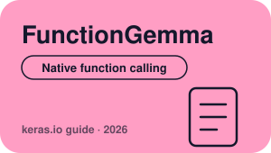</a>
  <a href="https://keras.io/keras_hub/guides/function_calling_with_keras_hub/">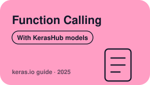</a>
  <br>
  <a href="https://keras.io/keras_hub/guides/rag_pipeline_with_keras_hub/">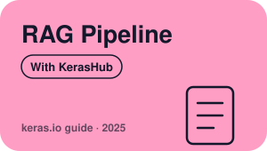</a>
  <a href="https://keras.io/keras_hub/guides/hugging_face_keras_integration/">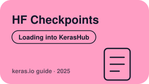</a>
</p>

## 📦 All merged pull requests

<!-- contributions:start -->
262 merged pull requests across 12 repositories in keras-team and TensorFlow. Open a category to see every one.

<details>
<summary><picture></picture></summary>

- [Add EmbeddingGemma2 model to Hub](https://github.com/keras-team/keras-hub/pull/3144) · keras-hub#3144
- [Register Qwen Agent World and Maxbai-ai presets to hub](https://github.com/keras-team/keras-hub/pull/2878) · keras-hub#2878
- [Add Mxbai(mixbread-ai) Embedding Model to Hub](https://github.com/keras-team/keras-hub/pull/2850) · keras-hub#2850
- [Add Qwen Agent World Model to Hub](https://github.com/keras-team/keras-hub/pull/2860) · keras-hub#2860
- [Register Magistral Presets to Hub](https://github.com/keras-team/keras-hub/pull/2845) · keras-hub#2845
- [Register BLIP2 model presets to hub](https://github.com/keras-team/keras-hub/pull/2805) · keras-hub#2805
- [Register Qwen 3.5 MoE Model Presets to Hub](https://github.com/keras-team/keras-hub/pull/2798) · keras-hub#2798
- [Add Qwen3.5 MoE Model to Hub](https://github.com/keras-team/keras-hub/pull/2665) · keras-hub#2665
- [Add Sentence-Transformers Embedding Model and add support with TextEmbedder Task API](https://github.com/keras-team/keras-hub/pull/2740) · keras-hub#2740
- [Add Export Safetensors format Support for Qwen3\_5 Model](https://github.com/keras-team/keras-hub/pull/2707) · keras-hub#2707
- [Update VIT presets versions and Map correct preset names in conversion script with kaggle preset names](https://github.com/keras-team/keras-hub/pull/2736) · keras-hub#2736
- [Register Qwen3.6 Model Presets to Keras-Hub](https://github.com/keras-team/keras-hub/pull/2720) · keras-hub#2720
- [Update T5Gemma2 presets version](https://github.com/keras-team/keras-hub/pull/2713) · keras-hub#2713
- [Add Qwen3.5 Model Presets to Hub](https://github.com/keras-team/keras-hub/pull/2678) · keras-hub#2678
- [Add Qwen 3.5 model to hub](https://github.com/keras-team/keras-hub/pull/2631) · keras-hub#2631
- [Register Gemma3N Presets to Hub](https://github.com/keras-team/keras-hub/pull/2676) · keras-hub#2676
- [Add Gemma 3n model to KerasHub](https://github.com/keras-team/keras-hub/pull/2606) · keras-hub#2606
- [Register T5Gemma2 Model Presets to Hub](https://github.com/keras-team/keras-hub/pull/2646) · keras-hub#2646
- [Add T5Gemma2 model to Hub](https://github.com/keras-team/keras-hub/pull/2619) · keras-hub#2619
- [Update model porting guidelines in CONTRIBUTING.md](https://github.com/keras-team/keras-hub/pull/2596) · keras-hub#2596
- [Register Embedding Gemma3 presets](https://github.com/keras-team/keras-hub/pull/2598) · keras-hub#2598
- [\[Gemma3 \] Embedding Gemma conversion script to load weights from HuggingFace to Kerashub](https://github.com/keras-team/keras-hub/pull/2589) · keras-hub#2589
- [Revert "Add Gemma3 Embedding Model Presets to Hub"](https://github.com/keras-team/keras-hub/pull/2577) · keras-hub#2577
- [Add Gemma3 Embedding Model Presets to Hub](https://github.com/keras-team/keras-hub/pull/2558) · keras-hub#2558
- [Changes to the Gemma3 backbone for Embedding Gemma model](https://github.com/keras-team/keras-hub/pull/2536) · keras-hub#2536
- [Add Qwen3 Coder preset and improve tokenizer robustness.](https://github.com/keras-team/keras-hub/pull/2567) · keras-hub#2567
- [Add Qwen 2.5 Math model presets and checkpoint conversion support](https://github.com/keras-team/keras-hub/pull/2566) · keras-hub#2566
- [Map new HF MedGemma model presets to conversion script](https://github.com/keras-team/keras-hub/pull/2541) · keras-hub#2541
- [Enable newly released Med Gemma 1.5 4B variant version to hub](https://github.com/keras-team/keras-hub/pull/2524) · keras-hub#2524
- [An automated script to port any Text-only decoder LLM model from Hugging Face to Keras Hub repo](https://github.com/keras-team/keras-hub/pull/2497) · keras-hub#2497
- [Add FunctionGemma checkpoints to kerasHub](https://github.com/keras-team/keras-hub/pull/2480) · keras-hub#2480
- [Register OpenAI GPT-OSS and GPT-OSS-SAFEGUARD Presets to kerashub.](https://github.com/keras-team/keras-hub/pull/2473) · keras-hub#2473
- [Generated GPT\_OSS model files through porter script.](https://github.com/keras-team/keras-hub/pull/2384) · keras-hub#2384
- [Add Gemma3 Conversion script to port weights from HF directly](https://github.com/keras-team/keras-hub/pull/2445) · keras-hub#2445
- [Add Presets,Checkpoint conversion for SmolLM3 model](https://github.com/keras-team/keras-hub/pull/2461) · keras-hub#2461
- [Register Qwen3 Embedding Presets to Kerashub](https://github.com/keras-team/keras-hub/pull/2455) · keras-hub#2455
- [Register MedGemma, MedSigLIP Presets to kerashub](https://github.com/keras-team/keras-hub/pull/2450) · keras-hub#2450
- [Register Cell2Sentence Presets](https://github.com/keras-team/keras-hub/pull/2442) · keras-hub#2442
- [Add and Register the Qwen3\_MoE Presets to Hub](https://github.com/keras-team/keras-hub/pull/2429) · keras-hub#2429
- [Register HGNetV2 presets](https://github.com/keras-team/keras-hub/pull/2326) · keras-hub#2326
- [Qwen3 presets register](https://github.com/keras-team/keras-hub/pull/2325) · keras-hub#2325
- [Fix Mistral conversion script](https://github.com/keras-team/keras-hub/pull/2306) · keras-hub#2306
- [Update preset versions for Mixtral,Qwen-MoE and Mistral models](https://github.com/keras-team/keras-hub/pull/2307) · keras-hub#2307
- [Update the sharded version number for Llama3 variants](https://github.com/keras-team/keras-hub/pull/2294) · keras-hub#2294
- [Update preset versions for sharded models](https://github.com/keras-team/keras-hub/pull/2264) · keras-hub#2264
- [Add Mixtral,Qwen-MoE presets and Update conversion script.](https://github.com/keras-team/keras-hub/pull/2248) · keras-hub#2248
- [Add Kaggle handle for moonshine presets](https://github.com/keras-team/keras-hub/pull/2253) · keras-hub#2253
- [Add qwen presets](https://github.com/keras-team/keras-hub/pull/2241) · keras-hub#2241
- [Update Qwen conversion script](https://github.com/keras-team/keras-hub/pull/2207) · keras-hub#2207
- [Update kaggle preset paths for SigLip model](https://github.com/keras-team/keras-hub/pull/2164) · keras-hub#2164
- [Fixing imports in init file and preset name update](https://github.com/keras-team/keras-hub/pull/2108) · keras-hub#2108
- [Basnet preset rename in kaggle](https://github.com/keras-team/keras-hub/pull/2097) · keras-hub#2097
- [BASNet Kaggle presets path update](https://github.com/keras-team/keras-hub/pull/2052) · keras-hub#2052
- [Add BASNet to keras hub](https://github.com/keras-team/keras-hub/pull/1984) · keras-hub#1984
- [Port Mask R-CNN to Keras3](https://github.com/keras-team/keras-cv/pull/2483) · keras-cv#2483

</details>

<details>
<summary><picture></picture></summary>

- [Split GPU and TPU tests into four shards](https://github.com/keras-team/keras/pull/24144) · keras#24144
- [Remove Jules integration](https://github.com/keras-team/keras-hub/pull/3262) · keras-hub#3262
- [Remove Jules integration](https://github.com/keras-team/shared-workflows/pull/24) · shared-workflows#24
- [Update linux test runner to linux-x86-n4-16](https://github.com/keras-team/keras-mlx/pull/141) · keras-mlx#141
- [Pin keras-openvino in CI until the chained top\_k regression is fixed](https://github.com/keras-team/keras-hub/pull/3251) · keras-hub#3251
- [Refresh GPU test durations from the latest master run](https://github.com/keras-team/keras-hub/pull/3221) · keras-hub#3221
- [Serialize site deploys and re-upload pages missing from the bucket](https://github.com/keras-team/keras-io/pull/2455) · keras-io#2455
- [Seed Gemma cache test and widen GPU tolerance for TF32 drift](https://github.com/keras-team/keras-hub/pull/3216) · keras-hub#3216
- [Retry the CUDA pip install in GPU CI on transient download failures](https://github.com/keras-team/keras-hub/pull/3206) · keras-hub#3206
- [Balance GPU test shards by measured test duration](https://github.com/keras-team/keras-hub/pull/3208) · keras-hub#3208
- [Pin torch to 2.14.\* in the CUDA requirements](https://github.com/keras-team/keras/pull/24091) · keras#24091
- [Speed up JAX GPU tests by unpinning jax](https://github.com/keras-team/keras-hub/pull/3199) · keras-hub#3199
- [Shard nightly CPU tests to match PR CI and avoid OOM](https://github.com/keras-team/keras-hub/pull/3198) · keras-hub#3198
- [Replace the PR template checklist with the contributor agreement](https://github.com/keras-team/keras-hub/pull/3171) · keras-hub#3171
- [Bump pull-request-validation pin to bypass check for all collaborators](https://github.com/keras-team/keras-hub/pull/3196) · keras-hub#3196
- [Bump pull-request-validation pin to bypass check for all collaborators](https://github.com/keras-team/keras/pull/24072) · keras#24072
- [Bypass the approved-issue check for all repository collaborators](https://github.com/keras-team/shared-workflows/pull/17) · shared-workflows#17
- [Pin pytest-xdist workers to 12 on CPU runner](https://github.com/keras-team/keras-hub/pull/3193) · keras-hub#3193
- [Update CPU test runner to linux-x86-n4-16](https://github.com/keras-team/keras/pull/24062) · keras#24062
- [Update CPU test runner to linux-x86-n4-16](https://github.com/keras-team/keras-hub/pull/3187) · keras-hub#3187
- [Update CPU test runner to linux-x86-n4-16](https://github.com/keras-team/keras-rs/pull/216) · keras-rs#216
- [Bump GPU tests timeout to 4 hours](https://github.com/keras-team/keras/pull/23983) · keras#23983
- [Relax Gemma4 vision retrace test tolerance on GPU](https://github.com/keras-team/keras-hub/pull/3165) · keras-hub#3165
- [Bump GPU CI torch pin to 2.14.1 for transformers 5.20](https://github.com/keras-team/keras-hub/pull/3168) · keras-hub#3168
- [Install keras-openvino plugin for OpenVINO CI jobs](https://github.com/keras-team/keras-hub/pull/3148) · keras-hub#3148
- [Make run-gpu-tpu-tests a one-shot label for the GPU and TPU test workflows](https://github.com/keras-team/keras/pull/23857) · keras#23857
- [Make run-gpu-tests a one-shot label for the GPU test workflow](https://github.com/keras-team/keras-hub/pull/3139) · keras-hub#3139
- [Add top-level permissions to stale workflow and fix zizmor ignores](https://github.com/keras-team/keras/pull/23844) · keras#23844
- [Tighten workflow triggers, token grants and secret scope](https://github.com/keras-team/keras-hub/pull/3136) · keras-hub#3136
- [\[Do not merge \] Remove .kokoro/ directory (migrated to GitHub Actions in #2939)](https://github.com/keras-team/keras-hub/pull/3025) · keras-hub#3025
- [Add GPU test workflow (migrate from Kokoro to GitHub Actions)](https://github.com/keras-team/keras-hub/pull/2939) · keras-hub#2939
- [Add TensorFlow-backend tests for backend\_utils.in\_tf\_graph](https://github.com/keras-team/keras/pull/23810) · keras#23810
- [Fix torch GPU failures in image classifier and PaliGemma tests](https://github.com/keras-team/keras-hub/pull/3119) · keras-hub#3119
- [flash attention mocks exercise the fused path](https://github.com/keras-team/keras-hub/pull/3115) · keras-hub#3115
- [Fix flaky test\_cholesky with fixed seed and float32 rtol](https://github.com/keras-team/keras/pull/23705) · keras#23705
- [Patch the public dot\_product\_attention op in flash attention tests](https://github.com/keras-team/keras-hub/pull/3114) · keras-hub#3114
- [Migrate PyPI publishing to OIDC Trusted Publishing](https://github.com/keras-team/kinetic/pull/318) · kinetic#318
- [Unpin Tensorflow-Text version cap (revert \<2.21.0 restriction)](https://github.com/keras-team/keras-hub/pull/3058) · keras-hub#3058
- [Run the full test suite for every backend on PRs and master merges](https://github.com/keras-team/keras-hub/pull/3059) · keras-hub#3059
- [Replace keras-team-review-pending with gTech-team-review-pending in Gemini triage allow-list](https://github.com/keras-team/keras/pull/23602) · keras#23602
- [Update Gemini guidelines to use gTech Team review Pending labels for issues](https://github.com/keras-team/shared-workflows/pull/5) · shared-workflows#5
- [Upgrade GPU Runner for GPU Tests](https://github.com/keras-team/keras/pull/23599) · keras#23599
- [Upgrade GPU runner in GPU Tests](https://github.com/keras-team/keras-rs/pull/204) · keras-rs#204
- [fix: replace keras-team-review-pending with gTech-team-review-pending in Gemini triage allow-list](https://github.com/keras-team/keras-hub/pull/3047) · keras-hub#3047
- [Fix torch distributed test timeouts in nightly CI](https://github.com/keras-team/keras/pull/23590) · keras#23590
- [Add weekly GPU workflow for \`@extra\_large\` tests](https://github.com/keras-team/keras-hub/pull/3041) · keras-hub#3041
- [CI : Extract CPU tests into reusable cpu\_tests.yml workflow](https://github.com/keras-team/keras-hub/pull/3037) · keras-hub#3037
- [CI: Extract CPU tests into reusable cpu\_tests.yml workflow](https://github.com/keras-team/keras/pull/23572) · keras#23572
- [Refactor CI: Extract CPU, GPU, and TPU tests into standalone reusable workflows](https://github.com/keras-team/keras-rs/pull/203) · keras-rs#203
- [Migrate to OIDC Trusted Publishing and add auto-publish workflow](https://github.com/keras-team/keras/pull/23557) · keras#23557
- [Migrate PyPI publishing to OIDC Trusted Publishing](https://github.com/keras-team/keras-hub/pull/3017) · keras-hub#3017
- [Fix all remaining zizmor audit failures](https://github.com/keras-team/keras-hub/pull/3024) · keras-hub#3024
- [Fix zizmor CI failure in nightly.yml](https://github.com/keras-team/keras-hub/pull/3023) · keras-hub#3023
- [Remove keras-team-review-pending from Gemini triage allowed\_labels](https://github.com/keras-team/keras-hub/pull/3016) · keras-hub#3016
- [Dynamically derive PROJECT\_URL versions from installed packages](https://github.com/keras-team/keras-io/pull/2413) · keras-io#2413
- [KerasHub version update to Enable vLLM Guide on keras-io](https://github.com/keras-team/keras-io/pull/2410) · keras-io#2410
- [Pin tensorflow-text\<2.21.0 to fix CI and Keras hub PyPi usage breakage](https://github.com/keras-team/keras-hub/pull/2979) · keras-hub#2979
- [Shard CI tests across 4 parallel jobs per backend to reduce wall-clock time](https://github.com/keras-team/keras-hub/pull/2864) · keras-hub#2864
- [Switch CI to self-hosted runners and parallelize tests to fix TF CPU timeouts](https://github.com/keras-team/keras-hub/pull/2856) · keras-hub#2856
- [Update keras version to 3.15](https://github.com/keras-team/keras-hub/pull/2852) · keras-hub#2852
- [Fix Zizmor security findings in GitHub Actions workflows & OpenSSF Scorecard](https://github.com/keras-team/keras-io/pull/2392) · keras-io#2392
- [Fix GitHub Actions workflows with Zizmor security audit](https://github.com/keras-team/keras-rs/pull/198) · keras-rs#198
- [Fix Zizmor security findings in GitHub Actions workflows](https://github.com/keras-team/keras/pull/23231) · keras#23231
- [Fix Zizmor security findings in GitHub Actions workflows](https://github.com/keras-team/keras-hub/pull/2792) · keras-hub#2792
- [Increase Kokoro GPU timeout for JAX, TensorFlow and PyTorch](https://github.com/keras-team/keras-hub/pull/2801) · keras-hub#2801
- [FIX: Pin SentencePiece\<0.2.2 to unblock CI test failures](https://github.com/keras-team/keras-hub/pull/2800) · keras-hub#2800
- [Fix GitHub Actions workflows with Zizmor security audit](https://github.com/keras-team/kinetic/pull/277) · kinetic#277
- [Update the kagglesdk version for gpu compatibility](https://github.com/keras-team/keras-hub/pull/2788) · keras-hub#2788
- [Pin kagglesdk==0.1.30 and surface kagglehub import errors](https://github.com/keras-team/keras-hub/pull/2787) · keras-hub#2787
- [Bump GitHub Actions versions to the latest](https://github.com/keras-team/keras/pull/23104) · keras#23104
- [Bump GitHub Actions versions to the latest](https://github.com/keras-team/kinetic/pull/272) · kinetic#272
- [Bump GitHub Actions versions to the latest](https://github.com/keras-team/keras-io/pull/2378) · keras-io#2378
- [Update keras version to 3.14](https://github.com/keras-team/keras-hub/pull/2752) · keras-hub#2752
- [Update assignee list](https://github.com/keras-team/keras-io/pull/2368) · keras-io#2368
- [Update assignee list](https://github.com/keras-team/keras/pull/22995) · keras#22995
- [Update Assignee list](https://github.com/keras-team/keras-hub/pull/2748) · keras-hub#2748
- [Exclude kagglehub 1.0.1 due to broken kagglesdk 0.1.24 compatibility](https://github.com/keras-team/keras-hub/pull/2747) · keras-hub#2747
- [Relax tolerance in OpenVINO export tests to fix nightly failures](https://github.com/keras-team/keras/pull/22826) · keras#22826
- [Fix nightly](https://github.com/keras-team/keras-hub/pull/2708) · keras-hub#2708
- [Add missing converter test file for smollm3](https://github.com/keras-team/keras-hub/pull/2636) · keras-hub#2636
- [Add SAM3 Converter Test File](https://github.com/keras-team/keras-hub/pull/2660) · keras-hub#2660
- [Add T5Gemma2 converter test file](https://github.com/keras-team/keras-hub/pull/2659) · keras-hub#2659
- [Add missing ViT converter test file](https://github.com/keras-team/keras-hub/pull/2637) · keras-hub#2637
- [Update transformers to latest version](https://github.com/keras-team/keras-hub/pull/2635) · keras-hub#2635
- [Add test file for convert\_gpt\_oss.py](https://github.com/keras-team/keras-hub/pull/2499) · keras-hub#2499
- [Fix keras-io integration test](https://github.com/keras-team/keras-hub/pull/2280) · keras-hub#2280
- [Add VGG preset test cases](https://github.com/keras-team/keras-hub/pull/2090) · keras-hub#2090

</details>

<details>
<summary><picture></picture></summary>

- [\[TF-Free Migration\] Make mock Gemma tokenizers work without TensorFlow](https://github.com/keras-team/keras-hub/pull/3097) · keras-hub#3097
- [\[PyGrain Migration\] Run RandomDeletion and RandomSwap in Grain pipelines](https://github.com/keras-team/keras-hub/pull/3065) · keras-hub#3065
- [\[PyGrain Migration\] Grain tokenizers](https://github.com/keras-team/keras-hub/pull/3066) · keras-hub#3066
- [\[PyGrain Migration\] Add pure Python paths to audio converters for Grain pipelines](https://github.com/keras-team/keras-hub/pull/3064) · keras-hub#3064
- [Migrate \`benchmarks/glue.py\` from TF-Keras to Keras 3](https://github.com/keras-team/keras-hub/pull/2976) · keras-hub#2976

</details>

<details>
<summary><picture></picture></summary>

- [Support loading unlisted backends via KERAS\_ALLOW\_UNOFFICIAL\_BACKEND](https://github.com/keras-team/keras/pull/24232) · keras#24232
- [Make Gemma4 vision pooling and interleave graph-safe for zero images](https://github.com/keras-team/keras-hub/pull/3156) · keras-hub#3156
- [Untrack the assistant model after Gemma4 speculative generate](https://github.com/keras-team/keras-hub/pull/3124) · keras-hub#3124
- [Honor add\_start\_token in CausalLMPreprocessor.generate\_preprocess](https://github.com/keras-team/keras-hub/pull/3132) · keras-hub#3132
- [Support Lanczos interpolation in torch backend resize](https://github.com/keras-team/keras/pull/23792) · keras#23792
- [Treat namespace packages as unavailable in LazyModule](https://github.com/keras-team/keras/pull/23713) · keras#23713
- [Openvino while loop capture and scalar repeat](https://github.com/keras-team/keras/pull/23613) · keras#23613
- [Resolve backend ops through the ops subpackage in DynamicBackend](https://github.com/keras-team/keras/pull/23693) · keras#23693
- [Fix OpenVINO compatibility in dynamic-shape ops and seq2seq generation loops](https://github.com/keras-team/keras-hub/pull/3046) · keras-hub#3046
- [Fix \`MultiSegmentPacker\` Python path to forward \`sequence\_length\`, \`add\_start\_value\`, and \`add\_end\_value\` to trimming](https://github.com/keras-team/keras-hub/pull/2907) · keras-hub#2907
- [Remove nested container warnings](https://github.com/keras-team/keras/pull/23172) · keras#23172
- [Fix SentencePieceTokenizer graph tracing by caching vocabulary via native sentencepiece](https://github.com/keras-team/keras-hub/pull/2706) · keras-hub#2706
- [Track untracked EOI variables in T5Gemma2 backbone](https://github.com/keras-team/keras-hub/pull/2709) · keras-hub#2709
- [Add build()method to Qwen3.5 vision encoder and remove workarounds](https://github.com/keras-team/keras-hub/pull/2710) · keras-hub#2710
- [Fix SentencePieceTokenizer failing inside tf.function by caching vocabulary eagerly](https://github.com/keras-team/keras-hub/pull/2691) · keras-hub#2691
- [Update Kaggle Models link to Keras organization page](https://github.com/keras-team/keras-hub/pull/2560) · keras-hub#2560
- [Incorrect condition on sliding\_window\_size](https://github.com/keras-team/keras-hub/pull/2289) · keras-hub#2289
- [Sharded weights type error](https://github.com/keras-team/keras-hub/pull/2296) · keras-hub#2296
- [Support None for max\_shard\_size](https://github.com/keras-team/keras-hub/pull/2261) · keras-hub#2261
- [Add QwencausalLM docstrings, covearage tracking, keras-io integration fix](https://github.com/keras-team/keras-hub/pull/2284) · keras-hub#2284
- [Made label data optional for inference and adopted other required changes](https://github.com/keras-team/keras-hub/pull/2183) · keras-hub#2183
- [Made y optional when we use for inference](https://github.com/keras-team/keras-hub/pull/2092) · keras-hub#2092

</details>

<details>
<summary><picture></picture></summary>

- [Sync Kaggle model presets to Hugging Face for 0.33.0](https://github.com/keras-team/keras-hub/pull/3223) · keras-hub#3223
- [\[Aug\] Sync kaggle models to HF keras](https://github.com/keras-team/keras-hub/pull/2936) · keras-hub#2936
- [Version bump to 0.32.0.dev0](https://github.com/keras-team/keras-hub/pull/2935) · keras-hub#2935
- [Version bump to 0.31.0](https://github.com/keras-team/keras-hub/pull/2934) · keras-hub#2934
- [Bump version to 3.12.4](https://github.com/keras-team/keras/pull/23356) · keras#23356
- [Bump version to 3.15.1](https://github.com/keras-team/keras/pull/23350) · keras#23350
- [Master Version bump to 0.31.0.dev0](https://github.com/keras-team/keras-hub/pull/2859) · keras-hub#2859
- [Version bump to 0.30.0](https://github.com/keras-team/keras-hub/pull/2858) · keras-hub#2858
- [\[JUL\] Sync kaggle models to HF](https://github.com/keras-team/keras-hub/pull/2802) · keras-hub#2802
- [Security Fixes 3.12.3](https://github.com/keras-team/keras/pull/23165) · keras#23165
- [Update keras dev version to 3.16.0](https://github.com/keras-team/keras/pull/23158) · keras#23158
- [Version bump to 0.29.1](https://github.com/keras-team/keras-hub/pull/2754) · keras-hub#2754
- [\[Release\] Version bump 0.29.1.dev0](https://github.com/keras-team/keras-hub/pull/2753) · keras-hub#2753
- [Version bump 3.11.2 and nnx fix #21565](https://github.com/keras-team/keras/pull/21570) · keras#21570
- [Version bump to 0.2.2.dev0](https://github.com/keras-team/keras-rs/pull/117) · keras-rs#117
- [Version bump to 0.2.1](https://github.com/keras-team/keras-rs/pull/116) · keras-rs#116
- [Version bump to 0.21.1](https://github.com/keras-team/keras-hub/pull/2285) · keras-hub#2285
- [Version bump 0.2.1.dev0](https://github.com/keras-team/keras-rs/pull/115) · keras-rs#115
- [Bump up master version to 0.22.0.dev0](https://github.com/keras-team/keras-hub/pull/2277) · keras-hub#2277
- [Version bump to 0.21.0](https://github.com/keras-team/keras-hub/pull/2275) · keras-hub#2275
- [Version bump 0.21.0.dev1](https://github.com/keras-team/keras-hub/pull/2273) · keras-hub#2273

</details>

<details>
<summary><picture></picture></summary>

- [Add FunctionGemma guide to keras](https://github.com/keras-team/keras-io/pull/2299) · keras-io#2299
- [A guide on RAG Pipeline with kerasHub models](https://github.com/keras-team/keras-io/pull/2158) · keras-io#2158
- [Update title for HF Guide](https://github.com/keras-team/keras-io/pull/2149) · keras-io#2149
- [Fix Rendering issue for FC guide](https://github.com/keras-team/keras-io/pull/2148) · keras-io#2148
- [Add FC guide to hub](https://github.com/keras-team/keras-io/pull/2143) · keras-io#2143
- [A guide to using the Function Calling feature with Keras Hub models](https://github.com/keras-team/keras-io/pull/2133) · keras-io#2133
- [Add API mapping table to HF Guide](https://github.com/keras-team/keras-io/pull/2130) · keras-io#2130
- [Address rendering issues in huggingface guide #2124](https://github.com/keras-team/keras-io/pull/2127) · keras-io#2127
- [Guide on how to load and inference keras hub model weights hosted on HF](https://github.com/keras-team/keras-io/pull/2124) · keras-io#2124
- [Highly accurate boundaries segmentation using BASNet to keras 3.0](https://github.com/keras-team/keras-io/pull/2038) · keras-io#2038

</details>

<details>
<summary><picture></picture></summary>

- [Add Magistral API details](https://github.com/keras-team/keras-io/pull/2399) · keras-io#2399
- [Add BLIP2 model API details and TextEmbedder base class API details to hub master](https://github.com/keras-team/keras-io/pull/2397) · keras-io#2397
- [Add Qwen3.5 MoE API Documentation to IO](https://github.com/keras-team/keras-io/pull/2391) · keras-io#2391
- [Add Keras 3.15.0 new APIs to docs](https://github.com/keras-team/keras-io/pull/2388) · keras-io#2388
- [Update KH Version and API details for Swin Transformer Model](https://github.com/keras-team/keras-io/pull/2371) · keras-io#2371
- [Add API docmentation for Gemma3n](https://github.com/keras-team/keras-io/pull/2348) · keras-io#2348
- [Add API docmentation for Qwen3.5](https://github.com/keras-team/keras-io/pull/2349) · keras-io#2349
- [API documentation Details for T5Gemma2](https://github.com/keras-team/keras-io/pull/2328) · keras-io#2328
- [Add usage API Doc For GPT-OSS](https://github.com/keras-team/keras-io/pull/2267) · keras-io#2267
- [Add Qwen3 API usage documentation to hub\_master.py](https://github.com/keras-team/keras-io/pull/2140) · keras-io#2140
- [Add HGNetV2 API documentation to hub\_master.py](https://github.com/keras-team/keras-io/pull/2141) · keras-io#2141
- [Add Mixtral,Qwen-Moe,Qwen,Xception API usage](https://github.com/keras-team/keras-io/pull/2101) · keras-io#2101
- [Add gpt neo X api doc to keras-io](https://github.com/keras-team/keras-io/pull/2091) · keras-io#2091
- [Add Flux,Xlnet,Gemma3 api docs to keras-io](https://github.com/keras-team/keras-io/pull/2089) · keras-io#2089
- [Add SigLip Api doc to keras-io](https://github.com/keras-team/keras-io/pull/2068) · keras-io#2068
- [Add CSPNet api doc to keras-io](https://github.com/keras-team/keras-io/pull/2066) · keras-io#2066
- [Add RematScope API to keras-io](https://github.com/keras-team/keras-io/pull/2080) · keras-io#2080
- [Add API doc for BasNet,Efficientnet,ViT,SegFormer,RetinaNet,MobileNet](https://github.com/keras-team/keras-io/pull/2062) · keras-io#2062
- [Add CLIP API doc in keras-io](https://github.com/keras-team/keras-io/pull/2057) · keras-io#2057

</details>

<details>
<summary><picture></picture></summary>

- [Update TFJS version speech-commands,tasks,toxicity and universal-sentence-encoder](https://github.com/tensorflow/tfjs-models/pull/1281) · tfjs-models#1281
- [Update TFJS version for models posenet and qna](https://github.com/tensorflow/tfjs-models/pull/1280) · tfjs-models#1280
- [Update TFJS version for models hand-pose-detection,handpose,knn-classifier and mobilenet](https://github.com/tensorflow/tfjs-models/pull/1279) · tfjs-models#1279
- [Update TFJS version for coco-ssd, depth estimation, face-detetction and gpt2.](https://github.com/tensorflow/tfjs-models/pull/1278) · tfjs-models#1278
- [Update TFJS version in demo for blazeface, body-pix, and body-segmentation](https://github.com/tensorflow/tfjs-models/pull/1282) · tfjs-models#1282
- [Update TFJS version for face-landmarks-detection](https://github.com/tensorflow/tfjs-models/pull/1283) · tfjs-models#1283
- [Update monorepo to 4.14.0.](https://github.com/tensorflow/tfjs/pull/8085) · tfjs#8085
- [Update monorepo to 4.14.0-rc.0.](https://github.com/tensorflow/tfjs/pull/8072) · tfjs#8072
- [Update TFJS version for blazeface, body-pix, and body-segmentation](https://github.com/tensorflow/tfjs-models/pull/1270) · tfjs-models#1270
- [Update website to latest dependencies.](https://github.com/tensorflow/tfjs-website/pull/512) · tfjs-website#512
- [Update lockfiles branch tfjs\_4.13.0\_lockfiles lock files.](https://github.com/tensorflow/tfjs/pull/8061) · tfjs#8061
- [Update monorepo to 4.13.0.](https://github.com/tensorflow/tfjs/pull/8054) · tfjs#8054
- [Update lockfiles branch tfjs\_4.13.0-rc.0\_lockfiles lock files.](https://github.com/tensorflow/tfjs/pull/8046) · tfjs#8046
- [Update monorepo to 4.13.0-rc.0.](https://github.com/tensorflow/tfjs/pull/8043) · tfjs#8043
- [Update website to latest dependencies.](https://github.com/tensorflow/tfjs-website/pull/510) · tfjs-website#510
- [Update lockfiles branch tfjs\_4.12.0\_lockfiles lock files.](https://github.com/tensorflow/tfjs/pull/8017) · tfjs#8017
- [Update verdaccio.yaml](https://github.com/tensorflow/tfjs/pull/8018) · tfjs#8018
- [Update monorepo to 4.12.0.](https://github.com/tensorflow/tfjs/pull/8013) · tfjs#8013

</details>

<details>
<summary><picture></picture></summary>

- [add Bharat and Lakshmikala to bot\_config.yml to assign github issues](https://github.com/tensorflow/models/pull/11236) · models#11236
- [Update setup.py](https://github.com/tensorflow/models/pull/11233) · models#11233
- [removed tf\_text requirement from setup.py for tf-models-no-deps pypi package](https://github.com/tensorflow/models/pull/11225) · models#11225
- [Update CODEOWNERS](https://github.com/tensorflow/models/pull/11182) · models#11182
- [Updated model building blocks API links in NLP Readme.md file to improve readability for users.](https://github.com/tensorflow/models/pull/11174) · models#11174
- [Adding Backbones,Decoders,Heads API links to Readme.md file in vision folder for more readability of the document](https://github.com/tensorflow/models/pull/11171) · models#11171
- [Update Readme.md file for examples and tutorials related to NLP and Vision using TensorFlow Model Garden](https://github.com/tensorflow/models/pull/11170) · models#11170
- [Typos corrected](https://github.com/tensorflow/models/pull/10942) · models#10942
- [typo correction in log message in train.py](https://github.com/tensorflow/models/pull/11027) · models#11027
- [Typo fix in TF doc](https://github.com/tensorflow/models/pull/11029) · models#11029
- [A list of assignees updated in bot\_config.yml](https://github.com/tensorflow/models/pull/11080) · models#11080
- [Updated doc according to new folder structure](https://github.com/tensorflow/models/pull/11036) · models#11036
- [Fixing Typos](https://github.com/tensorflow/models/pull/10922) · models#10922
- [Typos updated](https://github.com/tensorflow/models/pull/10907) · models#10907
- [Fixing Typos](https://github.com/tensorflow/models/pull/10919) · models#10919
- [Typo's corrected](https://github.com/tensorflow/models/pull/10912) · models#10912
- [Typo corrected](https://github.com/tensorflow/models/pull/10911) · models#10911
- [Typos Correction](https://github.com/tensorflow/models/pull/10898) · models#10898
- [Typos correction](https://github.com/tensorflow/models/pull/10897) · models#10897
- [Typos correction](https://github.com/tensorflow/models/pull/10896) · models#10896
- [Typos correction](https://github.com/tensorflow/models/pull/10894) · models#10894
- [typos corrected](https://github.com/tensorflow/models/pull/10902) · models#10902
- [Updated typos](https://github.com/tensorflow/models/pull/10901) · models#10901
- [typos correction](https://github.com/tensorflow/models/pull/10899) · models#10899
- [Typos Correction](https://github.com/tensorflow/models/pull/10900) · models#10900

</details>
<!-- contributions:end -->

## 🧰 Toolbox

<p align="center">
  <picture></picture>
</p>

## 👋 Find me

<p align="center">
  <a href="https://huggingface.co/laxmareddyp"></a>
  <a href="https://www.kaggle.com/laxmareddypatlolla"></a>
  <a href="https://www.linkedin.com/in/laxma-patlolla/"></a>
</p>
